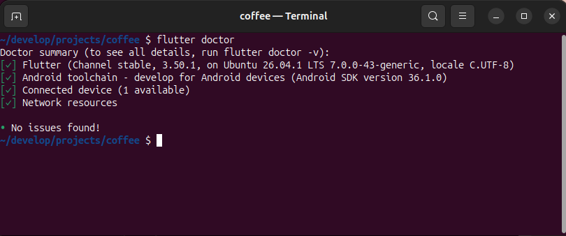
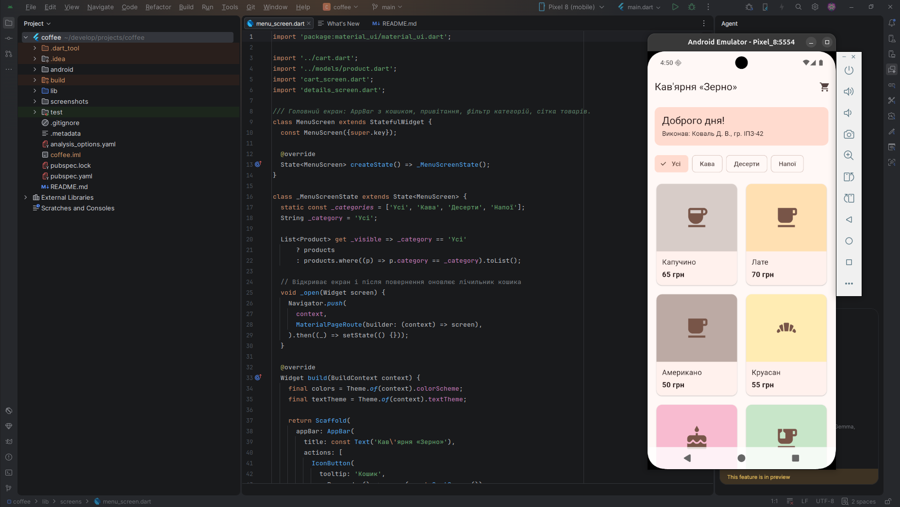
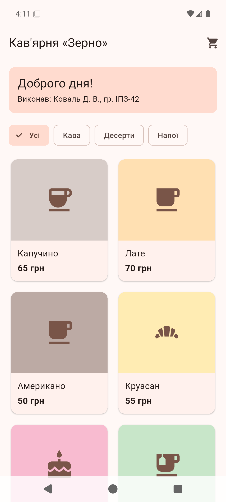
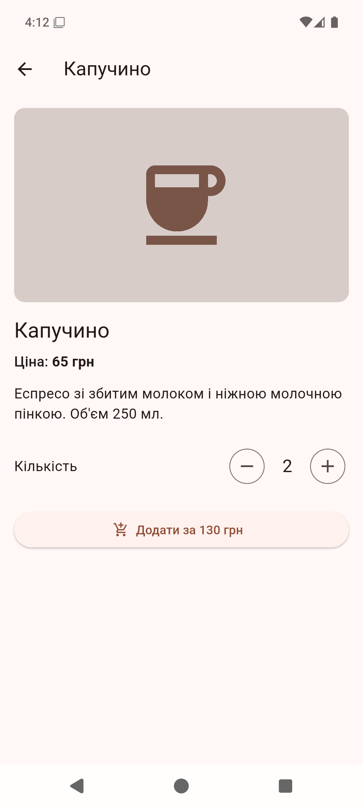
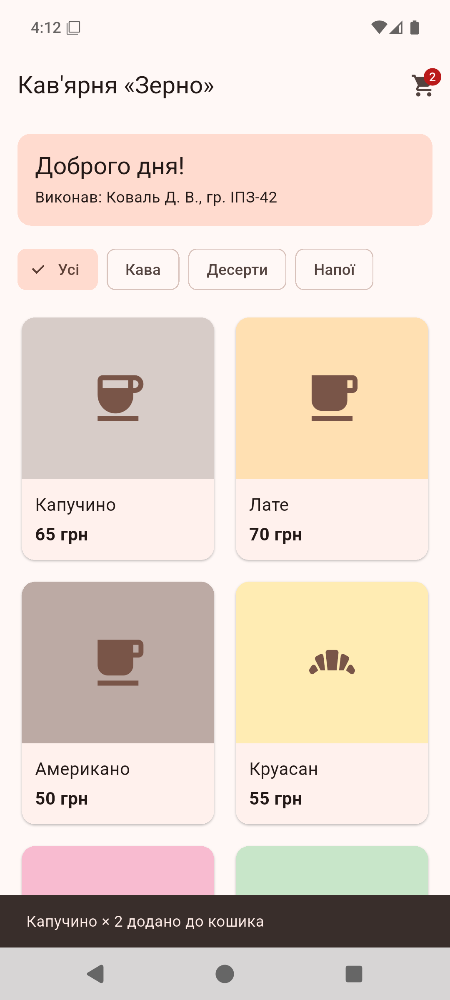
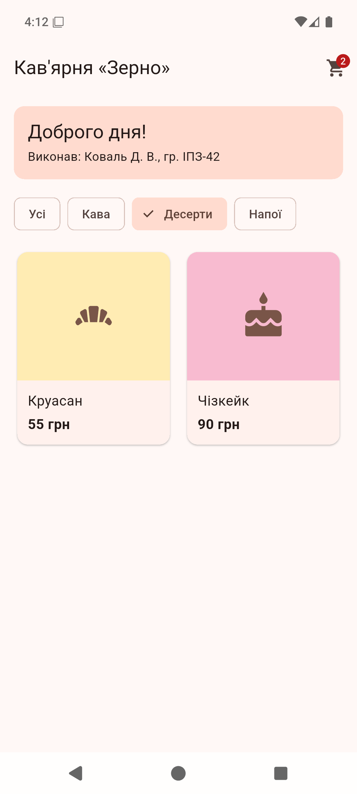
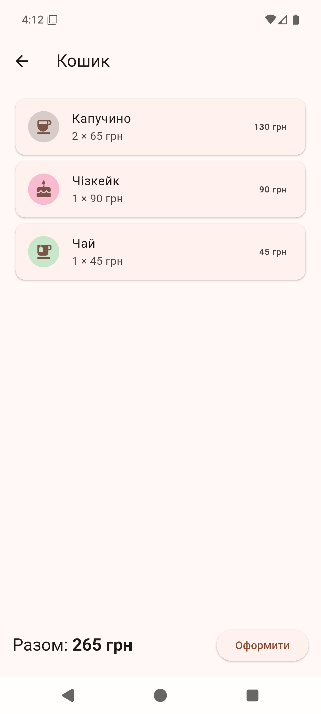
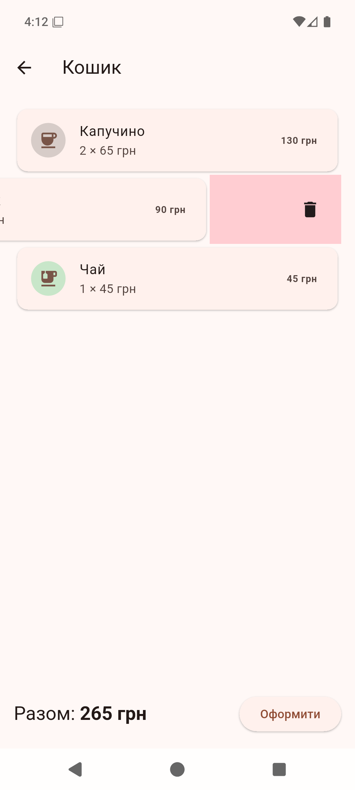
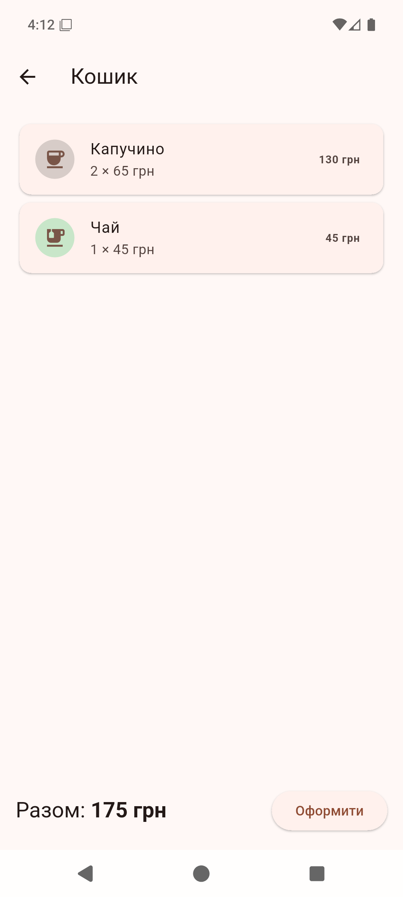

# coffee — кав'ярня «Зерно» на Flutter

| | |
|---|---|
| **Робота** | Лабораторна робота 3-5. Верстка інтерфейсу за макетом у Flutter. Багатоекранний застосунок |
| **Рівень** | Достатній |
| **Виконав** | Коваль Денис Віталійович, ІПЗ-42 |
| **Стек** | Flutter 3.50.1 (Dart 3.14), пакет `material_ui` 1.11.1, Android SDK 36, емулятор Pixel 8 (API 36) |
| **Платформа** | Android |

## Що це

Меню невеликої кав'ярні з кошиком. Чотири речі, які вміє застосунок:

- показати меню сіткою карток і відфільтрувати його за категорією («Усі», «Кава», «Десерти», «Напої»);
- відкрити товар, вибрати кількість і покласти в кошик — з'являється SnackBar, а на іконці кошика в AppBar росте лічильник;
- показати кошик зі списком позицій і загальною сумою;
- видалити позицію свайпом ліворуч, після чого сума одразу перераховується.

Екран «Оформлення замовлення» (високий рівень) не робився — кнопка «Оформити» в кошику лише показує повідомлення «Замовлення прийнято!», як і передбачено для достатнього рівня.

## Середовище

| Інструмент | Версія / що зроблено |
|---|---|
| Git | системний |
| Flutter SDK | 3.50.1, канал stable |
| Android Studio | 2026.2.2 + плагіни Flutter і Dart |
| Android SDK | Platform 36, Build-Tools 36.1.0, Platform-Tools, Command-line Tools, Emulator |
| Емулятор | Pixel 8, системний образ API 36 x86_64, апаратне прискорення KVM |

`flutter doctor` проходить без помилок у розділах Flutter і Android toolchain (скріншот 1). Окремого рядка «Android Studio» у Flutter 3.50 вже немає — цю перевірку прибрали з самого `flutter doctor`, тепер він лише бере JDK з установленої Android Studio.

## Структура проєкту

```
lib/
├── main.dart               корінь: MaterialApp + тема
├── cart.dart               кошик (CartItem, Cart, спільний екземпляр cart)
├── models/
│   └── product.dart        модель Product і список товарів
└── screens/
    ├── menu_screen.dart    «Меню» + власний віджет ProductCard
    ├── details_screen.dart «Деталі товару»
    └── cart_screen.dart    «Кошик»
```

Усі файли імпортують `package:material_ui/material_ui.dart` замість старого `package:flutter/material.dart` — з Flutter 3.47 Material винесено в окремий пакет.

## Дерева віджетів

Перед версткою кожен екран розкладено на блоки згори донизу.

**Меню**

```
Scaffold
├── AppBar
│   ├── Text «Кав'ярня «Зерно»»
│   └── actions: IconButton(tooltip: «Кошик»)
│       └── Badge(label: кількість у кошику)
│           └── Icon(shopping_cart)
└── Column
    ├── Container (primaryContainer, радіус 12, margin/padding 16)
    │   └── Column
    │       ├── Text «Доброго дня!» (titleLarge)
    │       └── Text «Виконав: Коваль Д. В., гр. ІПЗ-42»
    ├── Padding
    │   └── Wrap
    │       └── ChoiceChip × 4 (Усі / Кава / Десерти / Напої)
    └── Expanded
        └── GridView.builder (2 стовпці, проміжки 12, пропорція 0,8)
            └── ProductCard
                └── GestureDetector → Card (радіус 12)
                    └── Column
                        ├── Expanded → Hero(tag) → Container(product.color) → Icon(56)
                        └── Padding(12) → Column → Text(назва, 16) + Text(ціна, 16, bold)
```

**Деталі товару**

```
Scaffold
├── AppBar → Text(назва товару)
└── ListView (padding 16)
    ├── Hero(tag) → Container(height 220, радіус 12) → Icon(120)
    ├── Text(назва, headlineSmall)
    ├── RichText «Ціна: **65 грн**»
    ├── Text(опис)
    ├── Row «Кількість» ··· IconButton(−) · Text(n) · IconButton(+)
    └── ElevatedButton.icon «Додати за N грн»
```

**Кошик**

```
Scaffold
├── AppBar → Text «Кошик»
├── body: ListView.builder  (або Text «Кошик порожній»)
│   └── Dismissible(key: id товару, лише свайп ліворуч, червоне тло з іконкою)
│       └── Card → ListTile
│           ├── leading: CircleAvatar(product.color) → Icon
│           ├── title / subtitle «2 × 65 грн»
│           └── trailing: сума позиції
└── bottomNavigationBar: SafeArea → Row
    ├── Expanded → RichText «Разом: **N грн**»
    └── ElevatedButton «Оформити»
```

## Як влаштовано

**Тема.** Колір задано один раз у корені: `ThemeData(colorScheme: ColorScheme.fromSeed(seedColor: Color(0xFF6D4C41)))`. Звідси беруться і блок привітання (`primaryContainer`), і вибрані чипи, і кнопки, тож ніде в екранах коричневі відтінки вручну не прописані.

**Специфікація макета** перенесена як є: відступи екрана 16 dp, проміжки між картками 12, закруглення 12, пропорція картки 0,8, висота зображення в деталях 220, іконки 56 / 120, назва й ціна в картці 16 sp (ціна жирна), привітання — `titleLarge`. Тло кожного товару — його власне поле `Product.color`.

**Навігація.** `MenuScreen` відкриває інші екрани через `Navigator.push`, а товар передається у `DetailsScreen` через конструктор (`DetailsScreen(product: product)`). Повернення — `Navigator.pop`. Після повернення спрацьовує `.then((_) => setState(() {}))`, тому лічильник на кошику оновлюється одразу.

**Стан.** `DetailsScreen` і `CartScreen` — `StatefulWidget`. Кількість `_quantity` змінюється лише всередині `setState`; кнопка «−» отримує `onPressed: null`, коли кількість дорівнює 1, і стає неактивною. Сума на кнопці «Додати за … грн» перераховується сама при кожній перебудові.

**Кошик** — один спільний екземпляр `cart` (клас `Cart` зі списком `CartItem`). Якщо товар уже є, `add` збільшує його кількість, а не додає другий рядок. Геттери `count` і `total` рахують кількість одиниць для Badge і суму для «Разом».

**SnackBar** показується через `ScaffoldMessenger`, який належить усьому застосунку, тому повідомлення «Капучино × 2 додано до кошика» видно вже на екрані меню, після `pop`.

**Hero.** Кольоровий блок з іконкою в картці і великий блок на екрані деталей мають однаковий `tag: 'product-<id>'`, тож при переході він плавно «перелітає» і збільшується.

## Запуск

```bash
flutter pub get
flutter emulators --launch Pixel_8
flutter run
```

Перевірка коду:

```bash
flutter analyze   # No issues found!
flutter test      # тест меню: заголовок, рядок «Виконав», картка товару
```

## Демо

1. Результат `flutter doctor` — Flutter і Android toolchain без помилок, підключено емулятор



2. Android Studio з відкритим проєктом `coffee` (файл `menu_screen.dart`) і запущеним емулятором Pixel 8



3. Екран «Меню» — блок «Виконав: Коваль Д. В., гр. ІПЗ-42», фільтр і сітка карток



4. «Деталі товару» для капучино — кількість збільшено до 2, сума на кнопці 130 грн



5. Повернення в меню після додавання: SnackBar «Капучино × 2 додано до кошика» і лічильник 2 на іконці кошика



6. Меню з вибраним фільтром «Десерти»



7. Кошик із трьома товарами (капучино × 2, чізкейк, чай), разом 265 грн



8. Свайп ліворуч по чізкейку — під карткою червоне тло з кошиком для сміття



9. Після видалення чізкейка сума перерахувалась: 175 грн



## Підсумок

Середовище Flutter + Android SDK + емулятор налаштовано, проєкт `coffee` переведено на пакет `material_ui`. Зверстано три екрани за макетом і специфікацією, між ними працюють переходи з передаванням товару через конструктор. Для достатнього рівня додано вибір кількості зі `setState` і SnackBar, кошик на `ListView.builder` з видаленням через `Dismissible` і сумою в `RichText`, фільтр на `Wrap` + `ChoiceChip`, лічильник `Badge` в AppBar, тему з `ColorScheme.fromSeed` і Hero-анімацію між меню та деталями.
